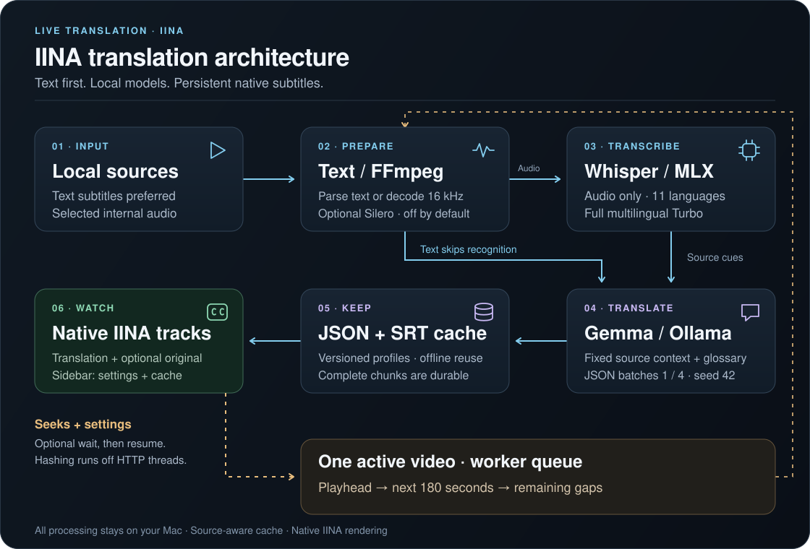

# Live Translation

**Native subtitles for IINA. Local speech translation for your Mac.**

[](https://github.com/avslyv/live-translation-iina/actions/workflows/ci.yml)
[](LICENSE)


Watch English videos in **IINA** with automatically generated **Russian subtitles**. Open a file, and the plugin prepares a translation, adds a normal subtitle track, and saves the result for your next viewing. Seeking, pausing, playback speed, subtitle styling, and full screen stay part of the player.

The original **system audio mode** is included too: capture YouTube, Zoom, Twitch, livestreams, or another app and display the original and translation side by side in a floating glass overlay.

Inference runs locally on Apple silicon using **MLX Whisper + Ollama**. No API keys, accounts, or cloud inference are required. Installation downloads dependencies and model weights; IINA playback uses the models already on your Mac.

<p align="center">
  
</p>

[Download installer](https://github.com/avslyv/live-translation-iina/releases/latest/download/Live-Translation-Installer-arm64.dmg) · [Quickstart](#quickstart--iina) · [Overlay mode](docs/OVERLAY.md) · [Architecture](docs/ARCHITECTURE.md) · [Русское руководство](IINA_SETUP_RU.md) · [Contributing](CONTRIBUTING.md)

## TL;DR

```text
IINA video ──► FFmpeg ──► Whisper / MLX ──► Gemma / Ollama
                                                │
             native IINA subtitles ◄── SRT ◄── JSON cache
```

- **Automatic:** opening a local video starts preparation and selects the Russian track.
- **Seek aware:** an uncached position becomes the next job. The player waits there and resumes when its subtitles are ready.
- **Update recovery:** the service restarts after updates and IINA reconnects automatically, preserving your pause and subtitle choices.
- **Persistent:** completed chunks survive restarts. Identical video content reuses the cache after a rename or move.
- **Reproducible:** fixed decoding settings, seed, model identities, and prompts; cached text is reused unchanged.
- **Native:** IINA renders a regular SRT track using its own font, size, position, visibility, and timing controls.
- **Local:** file audio goes straight to FFmpeg. No audio driver or microphone permission is needed for IINA mode.

## Who is this for?

- You watch English lessons, films, interviews, or documentaries in IINA and want Russian subtitles.
- You jump between parts of a video and want the translation to follow the playhead.
- You revisit videos and want the same saved translation instead of repeating inference.
- You want transcription and translation to run on your own hardware.
- You need captions for audio outside a video player; the separate overlay mode covers that workflow.

## Choose a mode

| | IINA subtitles | System audio overlay |
| --- | --- | --- |
| Input | Local video files | Audio from apps on your Mac |
| Output | Native IINA subtitle track | Floating bilingual glass overlay |
| Languages | English → Russian | Configurable source and target |
| Seeking | File timestamps, prioritized preparation | Follows live audio |
| Cache | Content-addressed JSON + SRT | Separate session history |
| Audio routing | Direct file decoding | BlackHole 2ch |
| Setup | [Download the installer](https://github.com/avslyv/live-translation-iina/releases/latest/download/Live-Translation-Installer-arm64.dmg) | [Overlay guide](docs/OVERLAY.md) |

## Quickstart — IINA

Requires an **Apple silicon Mac**, **macOS 14+**, and an internet connection for the first installation. You do not need Terminal, Homebrew, Python, FFmpeg, Ollama, or IINA already installed.

### 1. Download and open the installer

**[Download Live Translation Installer for Apple silicon](https://github.com/avslyv/live-translation-iina/releases/latest/download/Live-Translation-Installer-arm64.dmg)**

Open the disk image, then open **Live Translation Installer.app**. A [ZIP download](https://github.com/avslyv/live-translation-iina/releases/latest/download/Live-Translation-Installer-arm64.zip) is available too.

This community build is ad-hoc signed and is not notarized by Apple. If macOS blocks the first launch, review the release and follow [Apple's instructions for opening an app you trust](https://support.apple.com/en-us/102445). That may require **System Settings → Privacy & Security → Open Anyway**. No Terminal command is required.

### 2. Click Install Everything

The native installer shows each step and its progress. It installs or reuses the prerequisites, adds the IINA plugin and local service, and downloads Whisper and Gemma model weights. Existing model downloads, subtitle caches, and settings are retained; replaced integration settings are backed up.

Keep the disk image mounted until installation finishes. Model downloads are several gigabytes, so the first setup can take a while. When complete, use **Open IINA** and follow the restart reminder.

The installer uses your user account's application and support folders. It does not require Homebrew or administrator access. See the [installer guide](docs/INSTALLER.md) for details, retry behavior, and developer builds. The [cold-install report](docs/COLD_INSTALL_TEST.md) records the current validation status, evidence, and test limits separately from upgrade checks.

### 3. Open a video

**Quit and reopen IINA**, then open a local English video. Translation starts automatically; no plugin menu action or subtitle selection is needed.

When the current section has not been translated, the plugin shows **«Готовлю перевод этого участка…»**, pauses at the selected position, and resumes after loading the updated subtitle track. A pause you set yourself stays paused. You can resume manually to bypass that wait, hide subtitles, or select another track.

The plugin menu displays the prepared percentage. **100% means every section is cached** and all future seeks can reuse saved output. Before that, a first visit to a new section needs preparation. Errors or a wait longer than 45 seconds release an automatic pause while processing continues in the background.

An optional **Live Translation for IINA.app** launcher is installed in `~/Applications`. It starts the service and opens IINA. The upstream `LiveTranslate.app` in this repository belongs to overlay mode.

<details>
<summary>Command-line installation for developers</summary>

The original source installer remains available. Install Python 3.12+ (3.13 recommended), FFmpeg, Ollama, and IINA 1.3.5+, and start the local Ollama server first.

```bash
git clone https://github.com/avslyv/live-translation-iina.git
cd live-translation-iina
./setup-iina.sh
```

Use `./setup-iina.sh --dry-run` to preview the plan or `--no-download-models` to reuse downloaded weights. These commands are an alternative to the graphical installer.

</details>

## Models and memory

The IINA defaults are:

| Task | Model | Runtime |
| --- | --- | --- |
| English transcription | `mlx-community/whisper-large-v3-turbo` | MLX / Metal |
| Russian translation | `gemma4:12b` | Ollama / Metal |

You can select other locally compatible models during installation:

```bash
./setup-iina.sh \
  --whisper-model mlx-community/whisper-large-v3-turbo \
  --translation-model gemma4:12b
```

These flags change the model, not the IINA language pair. Model licenses apply separately; this repository does not distribute weights. Memory usage and preparation time depend on the model and hardware. The default pair was tested on an M4 Max with 36 GB of unified memory; no minimum-RAM performance claim is made for other Macs.

The worker hands memory from Whisper to Ollama instead of intentionally keeping both models resident. When at least 60 seconds ahead are cached, future work uses batches of up to four chunks to reduce repeated model loads. The first missing chunk at the playhead is processed individually. Models are released after 10 seconds idle, and background work stops when IINA no longer sends heartbeats.

## How it works

### File timestamps, not captured playback

IINA reports the file and playback position to an authenticated loopback service. FFmpeg decodes the file's first audio track into overlapping, fixed 30-second windows. Whisper words belong to a window by their timestamp midpoint, reducing boundary duplication. Words are grouped into phrases, translated with earlier context from the same window, and split into readable subtitle pages.

The scheduler prepares the playhead and the next 180 seconds first, then fills the remaining gaps. Explicit seeks cancel stale work. Recognition has its own cache, so a translation retry does not require recognizing the same speech again.

### A translation you can keep

The cache key combines **video content SHA-256** and a **generation profile**: model artifact identities, engine versions, prompt hash, segmentation, and inference settings. Completed chunks are written atomically.

```text
~/Library/Application Support/LiveTranslate/subtitles/
├── <key>.json                          # authoritative transcript + translation
├── <key>/Русский — Live Translation.srt # native subtitle track
└── recognition/<key>.json               # reusable English recognition
```

Whisper uses a fixed seed and one temperature-zero greedy pass. Translation uses temperature zero, `top_k=1`, a fixed seed, and fixed per-chunk context. Seeking does not alter the prompt history for a chunk. Existing cached translations are never regenerated just because you rewind.

New computation is not guaranteed to be bit-identical across different GPUs, engines, or model versions. **Reusing the committed cache is what guarantees the same saved subtitle text.** A changed profile creates a separate cache. A missing or damaged SRT is rebuilt from JSON without running the models.

### Loopback only

The bridge listens on `127.0.0.1:18743` and requires a generated local bearer token for file control and status. The installed plugin uses loopback-network and OSD permissions. IINA 1.5+ also requires its filesystem permission for native subtitle-file commands; older IINA versions do not. The scoped token stays outside the repository. Ollama runs on `127.0.0.1:11434`. Hugging Face downloads are disabled during IINA playback.

Python clients connect directly to validated loopback endpoints and allow redirects only within the same origin. A system HTTP proxy therefore does not receive these local service requests. Other applications' proxy settings are unchanged.

See [architecture and protocol](docs/ARCHITECTURE.md) and the [security policy](SECURITY.md) for details.

## System audio overlay

The original mode captures system audio and shows original speech and translation side by side:

```text
system audio ──► BlackHole ──► Whisper / MLX ──► Ollama ──► glass overlay
```

It includes Silero VAD, sentence assembly, hallucination filtering, optional rolling-buffer streaming, configurable languages, and a PyObjC overlay. It requires its own audio routing and dependencies.

**[Set up the overlay →](docs/OVERLAY.md)**

<details>
<summary>View the original overlay screenshot</summary>

<p align="center">
  
</p>

Screenshot from the upstream project. It illustrates overlay mode, not the native IINA track.

</details>

## Configuration and maintenance

```bash
./setup-iina.sh --help
```

| Option | Purpose |
| --- | --- |
| `--no-download-models` | Reuse installed model weights |
| `--no-start` | Install without loading the service immediately |
| `--no-launcher` | Skip the optional macOS launcher |
| `--iina /path/to/IINA.app` | Use a nonstandard IINA location |
| `--applications-dir ~/Applications` | Choose the launcher destination |
| `--locked` | Use the exact Python 3.13 dependency snapshot |

`requirements-iina.txt` contains direct IINA dependencies; `requirements-iina.lock.txt` records the tested Python 3.13 environment. Overlay dependencies remain in `requirements.txt` and `requirements.lock.txt`.

Check and restart the service:

```bash
curl --fail http://127.0.0.1:18743/health
launchctl kickstart -k "gui/$(id -u)/local.live-translation.iina"
```

Logs and backups are in `~/Library/Application Support/LiveTranslate/`. Use **Plugin → Локальные русские субтитры → Остановить перевод** to disable translation. This choice persists until you enable **Переводить автоматически** or **Включить и показать русский перевод** again.

To stop the service:

```bash
launchctl bootout "gui/$(id -u)/local.live-translation.iina"
```

To remove the integration, quit IINA, move `~/Library/LaunchAgents/local.live-translation.iina.plist` and `~/Library/Application Support/com.colliderli.iina/plugins/iina-plugin.iinaplugin-dev` out of their active locations, and remove the optional IINA launcher. Keep the Application Support folder if you want to retain saved subtitles. Model weights are shared with other tools and are managed separately.

## Troubleshooting

| Symptom | Check |
| --- | --- |
| No subtitle track | Reopen IINA after installation and enable **Переводить автоматически** in the plugin menu if you previously disabled it. |
| Waiting after a seek | The requested section is being prepared. Cached sections and a fully prepared file need no inference. |
| Ollama or model error | Run the latest graphical installer and open **Show Details** for the reason. Setup reuses completed downloads and checks the local models before activation. |
| Native model transfer rejected on a DNS/proxy route | The installer can fetch verified artifacts from the official registry and approved CDN. HTTPS validation and size/SHA-256 checks remain active; retry in the installer if a connection is interrupted. |
| Service unavailable | Open the IINA launcher, check `/health`, and inspect `iina-worker.log` / `iina-worker.error.log` in the Application Support folder. |
| High latency or memory use | Try a smaller locally compatible translation model. Keep other large inference jobs off the same GPU while measuring. |

Before attaching logs to an issue, remove tokens, private file paths, and transcript text.

## Limitations

- IINA mode currently supports local files, English → Russian, the first audio track, and one active video at a time.
- Network URLs, live streams inside IINA, DVD navigation, and audio-track switching are not implemented in the file bridge.
- Initial preparation and uncached seeks take time. A powerful Mac helps, but a new section cannot show a translation before it has been processed.
- Speech recognition and LLM translation can make mistakes, especially with music, accents, jargon, and mixed languages.
- IINA's plugin system is enabled by the installer; future IINA API changes may require updates.
- The graphical installer is currently ad-hoc signed rather than Apple-notarized. It downloads prerequisites and models during setup; weights are not bundled in the release archive.

## Project structure

```text
iina_bridge.py               file decoding, scheduling, model lifecycle, HTTP bridge
iina-plugin/                 native subtitle plugin for IINA
live_translation/            shared pipeline, translators, determinism, cache identity
tools/install_iina.py        portable IINA installer
setup-iina.sh                developer CLI setup entry point
installer/                   native macOS installer and bootstrap
tools/build_installer.py     signed app, DMG, ZIP and checksum packaging
live_translate_overlay.py   original system audio pipeline and Cocoa overlay
LiveTranslate.app/           original overlay app bundle
docs/                       architecture and overlay guide
tests/                      model-free Python and plugin lifecycle tests
.github/                    CI, issue forms, contribution templates
```

## Development

```bash
python3.13 -m venv .venv-dev
./.venv-dev/bin/pip install -r requirements-dev.txt -r .github/requirements-ci.txt
./.venv-dev/bin/python -m ruff check .
./.venv-dev/bin/python -m pyright
./.venv-dev/bin/python -m pytest -q
node --test tests/test_plugin_autostart.js
```

Linux also needs `libportaudio2` for overlay imports. Unit tests use fake inference and temporary files; they do not download models or capture audio. The MLX-specific test is skipped when MLX is unavailable. Native IINA behavior still requires manual testing on macOS.

See [CONTRIBUTING.md](CONTRIBUTING.md), [changes](CHANGELOG.md), and [the code of conduct](CODE_OF_CONDUCT.md).

## License and provenance

[MIT](LICENSE). This fork builds on [KazKozDev/live-translation](https://github.com/KazKozDev/live-translation), based on commit [`a729501`](https://github.com/KazKozDev/live-translation/commit/a729501b7c19b7e754484dcc1149b6c1df25107b). The original history and copyright notice are preserved.

The IINA plugin, seek-aware file bridge, deterministic cache, and installer are additions in this fork. IINA, FFmpeg, Whisper, MLX, Ollama, and model weights retain their respective licenses. This is an independent community integration.

Thanks to KazKozDev for the original project, the IINA and model-runtime maintainers, and [Alex Ziskind](https://github.com/alexziskind1) for the [benchmark](https://www.youtube.com/watch?v=PxUSE2KwyUQ) acknowledged upstream.
