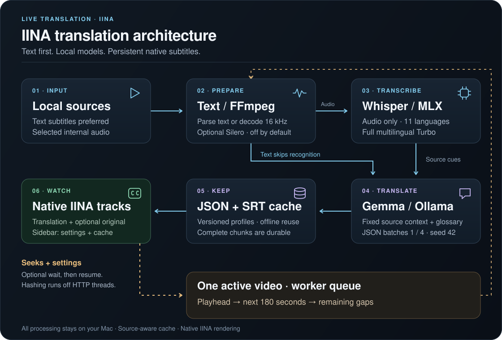

# Architecture

The IINA integration reads audio directly from a local video file and prepares a persistent Russian subtitle track. The original system-audio overlay remains a separate entry point.



## Components

| Component | Responsibility |
| --- | --- |
| `iina-plugin/main.js` | Observes file, playback and seek events; polls the worker; loads or refreshes a native subtitle track. |
| `iina_bridge.py` | Decodes audio, schedules missing sections, runs local inference and writes subtitle caches. |
| `live_translation/deterministic.py` | Fixes inference settings and records exact model and engine identities. |
| `live_translation/media_cache.py` | Identifies video content, validates cached cues and detects file changes. |
| `live_translation/text_pipeline.py`, `translators.py`, `sessions.py` | Reuses upstream text cleanup, translation prompts, Ollama transport and subtitle export. |

## Preparing a video

1. FFmpeg decodes the first audio track to mono, 16 kHz audio.
2. Work is divided into fixed 30-second sections with one second of decoding context. Word midpoints assign overlapping recognition output to one section, avoiding duplicate boundary words.
3. Whisper runs through MLX on the Mac's GPU. Recognized words become timed phrases using duration, length and pause boundaries.
4. Gemma runs through the local Ollama server and translates each phrase. Its context contains only earlier phrases from the same fixed section, in timestamp order.
5. Each completed section is saved to JSON. Russian cues are exported to a normal SRT file, which the plugin loads with mpv's `sub-add` or refreshes with `sub-reload`.

The worker prepares missing sections at the current position first, then the next 180 seconds, then the remaining gaps in the file. Preparation continues while playback is paused. Once at least 60 seconds are buffered, future work can use batches of up to four sections: recognize the batch, release Whisper, then translate it. The two models use memory in separate phases.

## Seeking and playback

A seek changes the work generation and makes the new position urgent. The worker checks the active file, generation and heartbeat before committing output; superseded work cannot write stale translations. Cancellation takes effect at these checks rather than interrupting an inference kernel in progress.

If the selected section is missing, the plugin shows a preparation message and pauses playback. It resumes only a pause that it owns, after the matching section is ready and its SRT is applied. A pause made by the viewer stays paused. Manually resuming, hiding subtitles or choosing another track cancels that wait. Errors and a 45-second timeout also release a plugin-owned pause.

Completed sections load from disk without inference. A completed silent section is also cached, with an empty cue list. Until the full file has been prepared, a seek to a missing section can still require recognition and translation.

## Cache identity and reproducibility

The subtitle cache key combines the SHA-256 of the video's bytes with the generation profile. File paths are not part of that identity, so unchanged copies and renamed files reuse the same translation. A cheap file-stat signature memoizes hashing within the worker and helps detect source changes.

The profile includes model artifact identities, engine versions, inference settings, the prompt template and segmentation settings. Whisper uses greedy decoding with temperature zero; translation fixes seed `42`, temperature `0`, `top_k=1`, `top_p=1`, and disables thinking and speculative decoding. History starts afresh for every fixed section, making the prompt independent of seek order.

Reusing a completed cache guarantees the same saved text. Fresh computation is not promised to be bit-identical across different hardware, kernels or engine versions. Changing the profile selects a different cache without deleting older results.

By default, files live under `~/Library/Application Support/LiveTranslate/subtitles/`:

```text
<key>.json                         # Authoritative translated cues and profile
<key>/Русский — Live Translation.srt # Native IINA subtitle track
recognition/<asr-key>.json          # Recognition results, independent of translation
```

Writes use temporary files followed by atomic replacement. Valid JSON can restore a missing or modified SRT without rerunning models. Recognition has its own identity, allowing unchanged speech work to survive a translation-profile change or an interrupted translation.

## Local service protocol

The worker binds to `127.0.0.1:18743` by default. The plugin sends one state request at a time, normally once per second, with immediate requests after seeks and playback restarts.

| Endpoint | Access | Purpose |
| --- | --- | --- |
| `GET /health` | Unauthenticated | Basic service identity and protocol version. |
| `POST /state` | Bearer token | Select a local file, update position/pause/seek state, or stop processing. Accepts JSON or form data; IINA uses form data. |
| `GET /status` | Bearer token | Diagnostic state, including current file, progress, playback state and plugin diagnostics. |

`POST /state` supplies `path`, `position`, `paused` and `enabled`. The plugin also supplies `seek_generation`, `native_russian_selected` and `waiting_for_translation`. Responses include readiness, SRT path/revision, preparation progress and errors. The service limits request bodies to 16 KiB and rejects unrelated browser origins. A delayed stop for an old file does not stop a newly selected file.

Heartbeats expire after 12 seconds without IINA updates. The worker then stops preparing new sections and releases models; after completing a file it unloads models after ten idle seconds. The lightweight service remains available through a per-user LaunchAgent.

## Privacy and boundaries

Recognition uses installed local Whisper weights; playback does not download models. Translation talks to Ollama on `127.0.0.1:11434`. Initial dependency and model installation requires network access.

The installer creates a scoped service token and embeds it only in the installed plugin, outside the source checkout. The installed plugin needs loopback networking and IINA OSD permissions. Audio is decoded from the file, without microphone capture or audio-device routing.

Caches contain transcript text, translations, timing and the source file path. They stay on the Mac and should be treated as private media-derived data. Diagnostic responses can also contain local paths; do not attach them to public issues without reviewing them.

The current IINA path supports one local video at a time, English speech to Russian text, and the first audio track. Network streams, DVD navigation and live changes to the selected audio track are outside this adapter's current scope.
